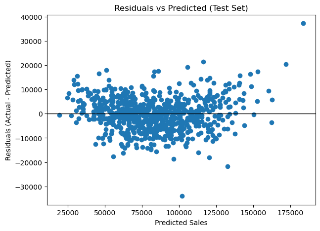
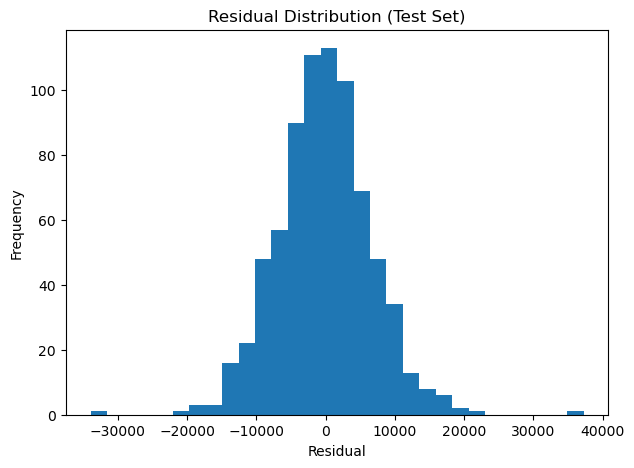
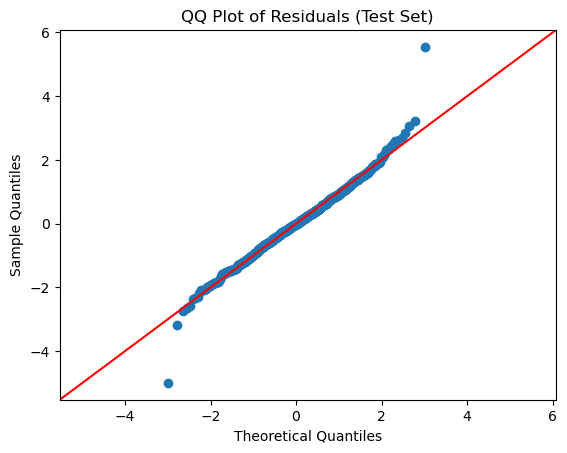
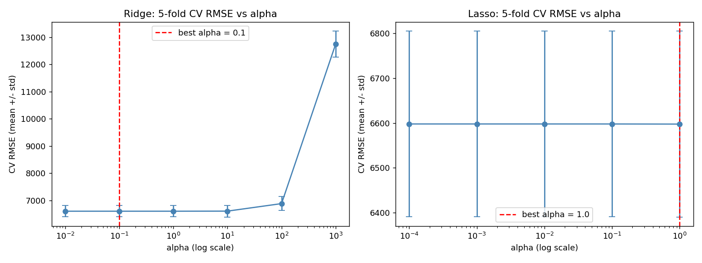
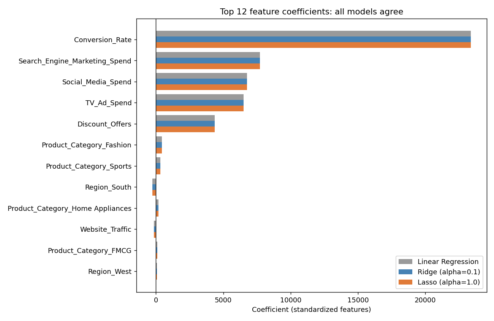
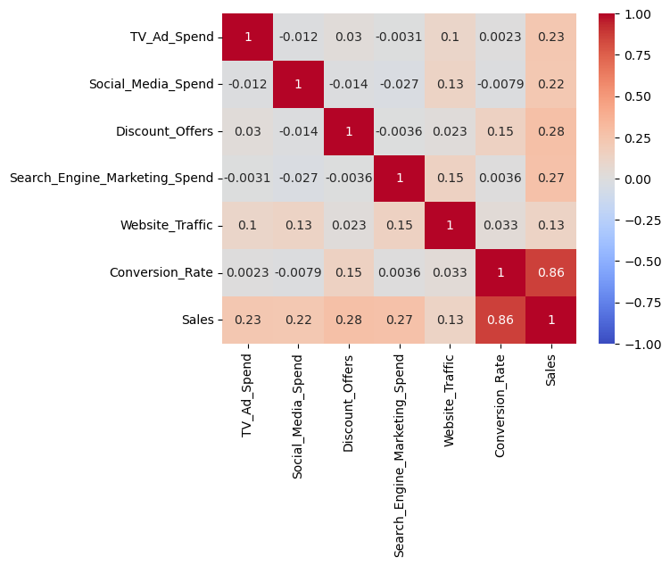

# Marketing Sales Prediction: Linear and Regularized Regression

Predicting **Sales** from marketing spend, discounts, website traffic, and customer/product attributes using Linear Regression, then testing whether Ridge, Lasso, and ElasticNet improve it.

---

## Table of Contents

- [Overview](#overview)
- [Dataset](#dataset)
- [Workflow](#workflow)
- [Results](#results)
- [Evaluation Visuals](#evaluation-visuals)
- [Key Findings](#key-findings)
- [Limitations and Next Steps](#limitations-and-next-steps)
- [Project Structure](#project-structure)
- [Getting Started](#getting-started)
- [Tech Stack](#tech-stack)

---

## Overview

Marketing teams need to know which levers actually move sales: TV, social media, search ads, discounts, or conversion quality. This project builds and interprets regression models on 2,500 records to answer that.

The notebook is split into two parts:

| Part | Focus |
|---|---|
| **Part 1: Linear Regression** | Data cleaning, EDA, encoding, baseline OLS and Linear Regression, assumption checks |
| **Part 2: Regularized Regression** | Ridge / Lasso / ElasticNet, K-Fold tuning, coefficient inspection, final model selection |

## Dataset

**File:** `market_sales.csv` | **Rows:** 2,500 | **Columns:** 10 | **Target:** `Sales`

| Column | Type | Description |
|---|---|---|
| `TV_Ad_Spend` | Numeric | TV advertising spend |
| `Social_Media_Spend` | Numeric | Social media spend |
| `Discount_Offers` | Numeric (discrete) | Discount level (0-30) |
| `Search_Engine_Marketing_Spend` | Numeric | Search engine marketing spend |
| `Product_Category` | Categorical | Electronics, Fashion, FMCG, Sports, Home Appliances |
| `Region` | Categorical | East, West, North, South |
| `Customer_Segment` | Categorical | Budget, Mid-tier, Premium |
| `Website_Traffic` | Numeric | Website traffic |
| `Conversion_Rate` | Numeric | Conversion rate |
| `Sales` | Numeric (target) | Sales / revenue outcome |

**Data quality:** no duplicate rows; missing values in `Discount_Offers` (7.3%), `Product_Category` (6.7%), `Social_Media_Spend` (6.2%), `Region` (5.1%), and `TV_Ad_Spend` (3.8%).

## Workflow

1. **Cleaning**
   - Mean imputation for `TV_Ad_Spend` and `Social_Media_Spend`
   - Random-sample imputation for `Discount_Offers` and `Region` (seeded with `np.random.seed(57)` for reproducibility)
   - Mode imputation for `Product_Category`
   - Cleaned file saved as `market_sales_nv_cleaned.csv`
2. **EDA:** count and pie charts, KDE plots, boxplots, average Sales by category, scatter plots vs. Sales, correlation heatmap
3. **Feature engineering:** one-hot encoding with `drop_first=True` (15 features)
4. **Baseline models:** statsmodels OLS summary and scikit-learn Linear Regression (70/30 split, `random_state=57`)
5. **Assumption checks:** linearity, VIF, Breusch-Pagan, Durbin-Watson, residual normality (histogram and QQ plot)
6. **Regularization:** StandardScaler fitted on train only, then Ridge, Lasso, and ElasticNet tuned with 5-fold cross-validation
7. **Final model selection** based on CV RMSE, CV stability, test performance, and coefficient behavior

## Results

### Baseline Linear Regression (test set)

| Metric | Value |
|---|---|
| R² (train / test) | 0.945 / 0.941 |
| MAE | 5,190 |
| RMSE | 6,759 |

Train and test R² are close, so the model is not overfitting.

### Regularized models (tuned with 5-fold CV)

| Model | Best Params | CV RMSE (mean ± std) | Test RMSE | Test R² |
|---|---|---|---|---|
| Linear Regression | n/a | n/a | 6,758.5 | 0.9411 |
| Ridge | alpha = 0.1 | 6,597.9 ± 207.0 | 6,758.5 | 0.9411 |
| **Lasso (selected)** | **alpha = 1.0** | **6,597.6 ± 207.0** | **6,758.3** | **0.9411** |
| ElasticNet | alpha = 0.001, l1_ratio = 0.9 | 6,597.9 ± 207.1 | 6,758.5 | 0.9411 |

### Assumption checks

| Check | Result | Reading |
|---|---|---|
| Multicollinearity (VIF) | All features < 2 | No multicollinearity concern |
| Breusch-Pagan p-value | 0.099 | No strong evidence of heteroscedasticity (> 0.05) |
| Durbin-Watson | 1.99 | No autocorrelation |

## Evaluation Visuals

### Residual diagnostics (test set)

**Residuals vs. predicted:** points scatter randomly around zero with no funnel shape, which matches the Breusch-Pagan result (p = 0.099). Two points sit far from the rest (about +37,000 and -34,000), so a handful of high-error cases exist.



**Residual distribution and QQ plot:** residuals are bell-shaped and centered on zero. The QQ plot follows the 45-degree line closely, with deviations only at the extreme tails. Normality is reasonably supported, which matters for the OLS p-values.

| Residual histogram | QQ plot |
|---|---|
|  |  |

### Model tuning (5-fold cross-validation)

CV RMSE is flat for small alpha and then climbs sharply: Ridge jumps to about 12,748 at alpha = 1000 because it over-shrinks the coefficients. In the useful range, the models are practically identical.



### Coefficient comparison

Linear Regression, Ridge, and Lasso produce almost the same coefficients, which is why regularization did not change accuracy. Conversion rate dominates, followed by the four marketing levers.



### Feature correlations



## Key Findings

- **Conversion rate is the dominant driver.** It has a 0.86 correlation with Sales and the largest coefficient (about +36,086 Sales per 1-unit increase, or +23,368 per standard deviation).
- **Spend channels rank by effect per unit spent:** search engine marketing (about +2.18) > social media (+1.71) > TV (+1.35). This assumes the same currency units and a linear effect.
- **Discounts help:** about +506 Sales per additional discount unit.
- **Category and region effects are small** relative to the model error (RMSE about 6,759). Fashion has the largest category effect (about +989 vs. Electronics), and Region South the largest negative (about -617 vs. East).
- **Regularization gave no meaningful accuracy gain.** All four models score nearly identically on test, and Lasso removed zero features. This is consistent with the low VIF values: with no multicollinearity and 2,500 rows, there is little for regularization to fix. Plain Linear Regression is a perfectly good choice here, and Lasso (alpha = 1.0) was selected because it had the lowest CV RMSE by a negligible margin.

## Limitations and Next Steps

- **Imputation happens before the train/test split**, so means and category frequencies come from all rows. Moving imputation into a scikit-learn `Pipeline` fitted on the training set would prevent this leakage.
- **Mode imputation inflated `Fashion`** (508 to 675 rows), and `Discount_Offers` was filled using only the values 10 and 15.
- **Coefficients show association, not causation.** Spend and sales may both follow seasonality or campaign timing that is not in the data.
- **Linear effects only.** Real ad spend usually has diminishing returns. Trying log transforms, interaction terms (for example, spend x category), or tree-based models (Random Forest, Gradient Boosting) could improve accuracy.
- The notebook includes a "Gen AI exploration" prompt for **outlier treatment**, which is a natural extension.

## Project Structure

```
.
├── Project1 - Marketing Sales Prediction Linear and Regularized Regression.ipynb
├── market_sales.csv                 # raw dataset (add this file yourself)
├── market_sales_nv_cleaned.csv      # generated by the notebook
├── images/                          # evaluation plots used in this README
│   ├── residuals_vs_predicted.png
│   ├── residual_histogram.png
│   ├── residual_qq_plot.png
│   ├── cv_tuning_curves.png
│   ├── coefficient_comparison.png
│   └── correlation_heatmap.png
└── README.md
```

## Getting Started

**1. Clone the repository**

```bash
git clone https://github.com/<your-username>/<your-repo>.git
cd <your-repo>
```

**2. Install dependencies**

```bash
pip install numpy pandas matplotlib seaborn scipy statsmodels scikit-learn jupyter
```

**3. Add the data**

Place `market_sales.csv` in the same folder as the notebook, or update the path in the "Load the dataset" cell.

**4. Run the notebook**

```bash
jupyter notebook
```

Run all cells in order. Random seeds are fixed (`57`) so results are reproducible.

## Tech Stack

Python | pandas | NumPy | Matplotlib | Seaborn | statsmodels | scikit-learn | SciPy | Jupyter

## Author

**Nazmin Ansari**
[LinkedIn](https://www.linkedin.com/in/nazmin-ansari-69357831a/))

